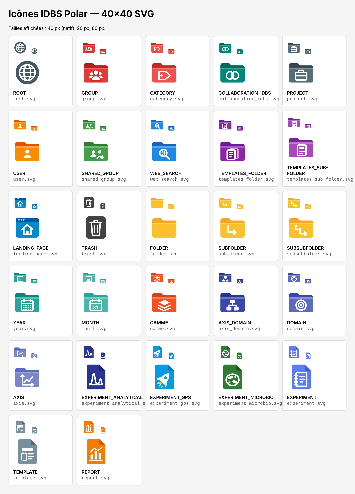

# Icônes IDBS Polar — dossiers de l'arborescence

27 icônes 40×40 px pour l'arborescence Polar (21 dossiers + 6 expériences/documents), en **SVG** (client web) et en **PNG transparent** (client lourd).

- `svg/` : sources vectorielles 40×40
- `png/40/` : PNG 40×40 (taille native)
- `png/16/` : PNG 16×16 (taille habituelle d'un arbre Windows, si le client lourd en a besoin)



| Type Polar | Fichier | Idée |
|---|---|---|
| ROOT | `svg/root.svg` | Globe — racine du système |
| GROUP | `svg/group.svg` | Dossier rouge, équipe |
| CATEGORY | `svg/category.svg` | Dossier rouge clair, étiquette |
| COLLABORATION_IDBS | `svg/collaboration_idbs.svg` | Dossier vert canard, cercles entrelacés |
| PROJECT | `svg/project.svg` | Dossier ardoise, mallette |
| USER | `svg/user.svg` | Dossier orange, personne |
| SHARED_GROUP | `svg/shared_group.svg` | Dossier vert, personnes + partage |
| WEB_SEARCH | `svg/web_search.svg` | Dossier bleu, loupe/web |
| TEMPLATES_FOLDER | `svg/templates_folder.svg` | Dossier violet, pile de modèles |
| TEMPLATES_SUB-FOLDER | `svg/templates_sub_folder.svg` | Dossier violet clair, modèle |
| LANDING_PAGE | `svg/landing_page.svg` | Fenêtre navigateur + accueil |
| TRASH | `svg/trash.svg` | Corbeille |
| FOLDER | `svg/folder.svg` | Dossier jaune simple |
| SUBFOLDER | `svg/subfolder.svg` | Dossier jaune, 1 niveau ↳ |
| SUBSUBFOLDER | `svg/subsubfolder.svg` | Dossier jaune, 2 niveaux ↳↳ |
| YEAR | `svg/year.svg` | Dossier turquoise, calendrier 12 mois |
| MONTH | `svg/month.svg` | Dossier turquoise clair, calendrier « 31 » |
| GAMME | `svg/gamme.svg` | Dossier orange brûlé, couches empilées |
| AXIS_DOMAIN | `svg/axis_domain.svg` | Dossier indigo foncé, organigramme |
| DOMAIN | `svg/domain.svg` | Dossier indigo, cible |
| AXIS | `svg/axis.svg` | Dossier indigo clair, axes + courbe |
| EXPERIMENT_ANALYTICAL | `svg/experiment_analytical.svg` | Page bleu nuit, chromatogramme |
| EXPERIMENT_GPS | `svg/experiment_gps.svg` | Grand Projet Stratégique / recherche avancée — page bleu ciel, fusée |
| EXPERIMENT_MICROBIO | `svg/experiment_microbio.svg` | Page verte, boîte de Petri |
| EXPERIMENT | `svg/experiment.svg` | Page bleue, cahier de laboratoire |
| TEMPLATE | `svg/template.svg` | Page gris-bleu, mise en page |
| REPORT | `svg/report.svg` | Page orange, graphique |

## Logique couleur
- Rouge : organisation (GROUP, CATEGORY) — reprend les icônes rouges actuelles.
- Jaune : rangement générique (FOLDER, SUBFOLDER, SUBSUBFOLDER).
- Turquoise : rangement chronologique (YEAR, MONTH).
- Indigo dégradé foncé → clair : hiérarchie AXIS_DOMAIN → DOMAIN → AXIS.
- Violet : dossiers de modèles.
- Forme « page à coin plié » = expérience ou document ; forme « dossier » = conteneur. Les couleurs des expériences reprennent celles des icônes Polar actuelles (bleu nuit, bleu ciel, vert).

## Modifier / régénérer
Couleurs et pictogrammes sont définis dans `generate.py` :

```
python3 generate.py   # réécrit svg/ et preview.html
node export_png.js    # réécrit png/40 et png/16 (Playwright + Chromium)
```
